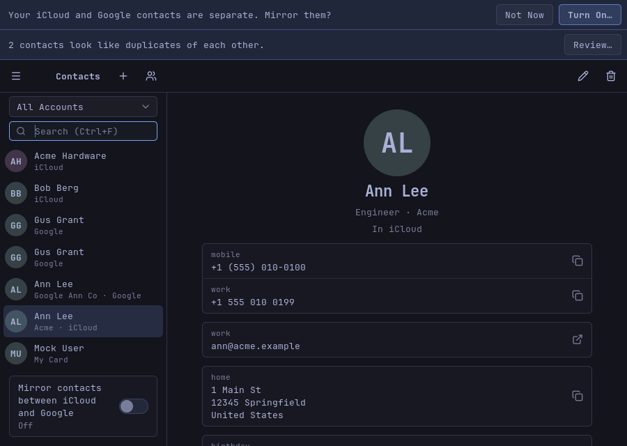

# Cloud Contacts

Your iCloud and Google contacts side by side on [Omarchy](https://omarchy.org) (and any Arch
Linux): a GTK 4 window themed by Omarchy and a command line for scripts and AI agents. Search, call,
email, add, edit, delete and export as vCard, in either account.



Each contact lives in one account, and a change goes to that account alone: the window shows
both accounts together, labelled, with a filter for one. If you want, Cloud Contacts can also mirror
your contacts between iCloud and Google ([below](#mirroring-icloud-and-google)).

## Install

On Omarchy or Arch Linux (x86_64 or aarch64):

```sh
curl -fsSL https://ferdousbhai.com/cloud-contacts/install.sh | sudo bash
```

It trusts the package-signing key, adds the `[cloud-contacts]` pacman repository and installs the
package; updates then arrive with `omarchy update`. The package replaces `icloud-contacts`, iCloud
for Omarchy's Contacts app: your iCloud contacts appear here on the first run, through the same
iCloud sign-in.

Open it from the app launcher (Contacts) or with `cloud-contacts open`. The window follows Omarchy's theme and
language (English for now).

After 0.4.4 the app has one name, `cloud-contacts`: the desktop entry is `cloud-contacts.desktop`, the icon
`cloud-contacts`, and the window's class in Hyprland `cloud-contacts` (it was `com.ferdousbhai.cloudcontacts`, so a
window rule of yours that matched that class needs the new one). The window's binary moved off `PATH` to
`/usr/lib/cloud-contacts/`; `cloud-contacts-app` stays on `PATH` as a launcher that runs `cloud-contacts open`, so a
keybinding that ran it still works. The command
line's exit codes are 0 and 1 alone; a script that told failures apart by the code reads the JSON error's `code`.

## Accounts

```sh
cloud-contacts account add icloud    # through icloud-session, the iCloud sign-in your iCloud apps share
cloud-contacts account add google    # in your browser, through Google's Workspace CLI (gws)
cloud-contacts status                # what is linked, and signed in
```

The window's accounts menu does the same. iCloud needs `icloud-session` (from
[iCloud for Omarchy](https://github.com/ferdousbhai/icloud-for-omarchy)); Google needs `gws`:
`npm install -g @googleworkspace/cli`. Cloud Contacts keeps Google's sign-in in its own
directory, `~/.config/cloud-contacts/gws/<account>`, apart from any gws setup of yours. Unlinking
an account forgets it on this computer; its contacts stay in the account.

One Google sign-in serves [Cloudmail](https://github.com/ferdousbhai/cloud-mail),
[Cloud Calendar](https://github.com/ferdousbhai/cloud-calendar) and Cloud Contacts. When one of
the other two is already signed in to Google on this computer, `account add google` uses that
sign-in and opens no browser, and says which address it took. Otherwise the browser sign-in asks
for what the three apps use (your mail and its filters, your events and calendar list, your
contacts), so the other two won't ask again; Cloud Contacts itself touches your contacts only.
The sign-in it took is a copy in its own directory, so unlinking in one app leaves the others
signed in. To use another Google account than the one it took, run
`cloud-contacts account login google`: an account that is signed in always gets the browser.

## Everyday use

- **Browse and search**: every contact, sorted by last name, each labelled with its account. The
  filter above the list shows one account.
- **Copy, call, email**: a click copies a phone number or address; emails and links open.
- **Add**: the new contact goes to the account you pick (the one the filter shows, to start).
- **Edit**: names, company, phones, emails, URLs, birthday and notes. What the window does not
  show (photos, social profiles, Google's labels and groups) stays as the account has it. Cancel,
  Escape or closing the window asks before it discards what you typed, and only Discard loses it.
- **Delete**: from the account it is in, on every device. iCloud keeps no Recently Deleted for
  contacts; Google keeps them in its Trash for 30 days.

## Keyboard

| Key | Does |
|---|---|
| Ctrl+N | New contact |
| Ctrl+E | Edit the chosen contact |
| Ctrl+F | Search: type a name, a company, a number or an address |
| Enter, in the search | Opens the first match |
| Up, Down | The contact above or below in the list |
| Ctrl+R, F5 | Fetch every account now |
| Escape, Alt+Left | In a narrow window, back from a contact to the list |
| F1, Ctrl+? | Show or hide every shortcut in the window |
| Ctrl+W, Ctrl+Q | Close the window |
| Enter, in a dialog | Save, or the dialog's default answer (never the one that deletes or discards) |
| Escape, in a dialog | Cancel; with something typed, it asks before discarding it |
| Alt and a button's underlined letter | That button: Alt+S saves, Alt+C cancels |
| Ctrl+Z, Ctrl+Shift+Z | Undo and redo what you typed in a field |

A deleted contact cannot be brought back from here, which is why Delete asks first: the accounts
offer no way to restore one whole (its photo, its groups and its ID), and iCloud keeps no trash.
Google keeps it in its own Trash for 30 days.

## Mirroring iCloud and Google

With an iCloud and a Google account both linked, you can mirror them: a contact
added, changed or deleted in one is added, changed or deleted in the other. It is off until you
turn it on: the window offers it at the top (Turn On… or Not Now) and has a switch, "Mirror
contacts between iCloud and Google", below the contacts, with how it stands under it. From the command
line:

```sh
cloud-contacts mirror          # on or off, how many are linked, the last run, any problem
cloud-contacts mirror on       # asks first; then a timer mirrors them every few minutes
cloud-contacts mirror run      # now
cloud-contacts mirror off      # both accounts keep their contacts as they are
```

- **Turning it on** joins contacts already in both accounts (a shared email or phone and a
  similar name) instead of copying them, and lists the doubtful ones for you to call one person
  or two (`mirror pair` / `mirror apart`, or in the window); neither is copied until you
  decide. Everything else is copied to the other account.
- **What crosses**: names, nickname, company, job title, department, birthday, notes, phones,
  emails, URLs and addresses, and whether a card is a company's (Google has no such setting, so
  Cloud Contacts keeps a mark of its own on the Google contact, which Google shows nowhere). **What never crosses**: photos, Google's labels and groups, and the
  fields only iCloud has (social profiles, related names and the like); each account keeps its
  own, and nothing of them is removed.
- **Changed on both sides**: phones, emails, URLs and addresses are joined, without duplicates; a
  single field takes the later change (iCloud's when the times are unknown, with a warning).
- **Guards**: a run that would delete more than 10 contacts, or more than half the linked ones,
  stops and lists them until you confirm with `mirror run --yes`. When an account can't be
  read, a run changes nothing.
- **When**: the timer runs while this computer is on; changes made on your phone cross once a
  computer with Cloud Contacts is awake. Unlinking either account turns it off; both keep their
  contacts. Cloud Contacts 0.4.0 and 0.4.1 called this keep-same; that command still works for
  now, and its links carry over.

## Duplicates

Cloud Contacts finds contacts that may be one person and merges them for you, losing nothing.
The window says how many look like duplicates, above the contacts; Review… (or Duplicates… in
the main menu, beside Refresh) shows them:

- **Likely the same**: a shared phone or email, whatever the names (one number is one person;
  the name not kept becomes the nickname, so search finds either); or the same full name or
  company (case, punctuation, spaces and accents aside), even with other numbers: merging
  keeps them all. Merge All merges them, each group into one card.
- **Check these**, a pair at a time: the same first name alone (first names are common), or
  the same full name with different birthdays. Merge, or Keep Apart (they are not shown again). A first name inside a
  fuller one with nothing in common (Jack and Jack (Club)) is not a duplicate.
- **In both accounts**: one in iCloud and one in Google; mirroring pairs these.

```sh
cloud-contacts duplicates                 # the groups, how sure, why, and the card each would become
cloud-contacts merge --all                # every likely group (asks first)
cloud-contacts merge CONTACT CONTACT...   # these, into one
cloud-contacts duplicates apart CONTACT CONTACT...   # different people: not shown again
```

A merge keeps every phone, email, URL and address of them all (a number written another way,
`0408 400701` and `+358 40 8400701`, once); the fuller name, with the other name as the nickname
(or a line in the notes) when it is more than another spelling; fields only one has; and, where
both have a field differently, the kept one's, with the other's in the notes (`Also: Company:
…`). Notes are joined. The card kept is the one with the most in it, so its photo and the fields
this app does not show stay; in Google, it joins the others' contact groups. Before anything is
deleted, every card is saved as a vCard to `~/.local/share/cloud-contacts/merged-backup/<date>.vcf`;
then the kept card is updated; only then are the others deleted.

## Command line

```sh
cloud-contacts list [QUERY] [--account NAME]
cloud-contacts show CONTACT            # an ID (icloud:..., google:people/...), `me`, a name, an email or a phone
cloud-contacts add --account google --first Ann --last Lee --phone work=+1 555 0100
cloud-contacts edit CONTACT --job-title Manager --remove-email old@example.com
cloud-contacts delete CONTACT --yes
cloud-contacts export [CONTACT...] -o contacts.vcf
cloud-contacts refresh                 # fetch every account now
```

Text on a terminal, a JSON envelope when piped (`--json`, `--quiet`, `--ids-only`, `--count`).
An account that fails while the others answer is a warning (`meta.warnings`), not an error.
A command exits 0 when it did what it was asked and 1 when it did not, with the error on stderr
(the JSON error object when piped or with `--json`, whose `code` says what went wrong) and nothing
on stdout. `cloud-contacts open` opens the window. `cloud-contacts --help` has the rest. For coding
agents, `cloud-contacts skill install` installs the agent skill.

## From source

```sh
cargo build --release        # needs gtk4 for the window
target/release/cloud-contacts --help
```

## License

MIT. See [LICENSE](LICENSE), [NOTICE](NOTICE) and [THIRD_PARTY_NOTICES.md](THIRD_PARTY_NOTICES.md).
